<!-- Uday Katrodiya · Shopify Plus Engineer -->

<a href="https://www.upwork.com/freelancers/~015962f628ed643a50">
  
</a>

<!-- Add LinkedIn here when ready:

-->

 


  

  
  

  
  

  
  

<b>More stores I've built for</b>

 

| Brand | What I built |
| :--- | :--- |
| **Supplements brand** | Full custom build: bundles and stacks, sample packs, shop-by-goal navigation, rewards and ambassador programs. |
| **Eyewear brand** | Product customiser with dynamic lens selection. |
| **Wall art brand** | Online Store 2.0 theme, custom artist commissions, reporting dashboard and API workflows. |
| **Tea brand** | Custom theme development. |
| **Shipping price test** | A shipping price split test for a non-Plus store using a carrier service, with backup rates so checkout never breaks. |
| **B2B draft orders** | A dashboard that records every wholesale draft order change, so the team can see what changed and when. |
| **Sales and GST exports** | Line-item sales and GST exports for four stores, reconciled to Shopify to the cent, for the auditors. |

 

 

  

  

Online Store 2.0 · Dawn &amp; Horizon · metafields &amp; metaobjects · Bulk Operations · Markets &amp; B2B · App Proxy · webhooks · POS GA4 · Tag Manager · Meta Pixel · Klaviyo · Lightspeed · Coveo · Unbxd · Google Places API · Lighthouse

 



  


  

<a href="https://www.upwork.com/freelancers/~015962f628ed643a50">
  
</a>
